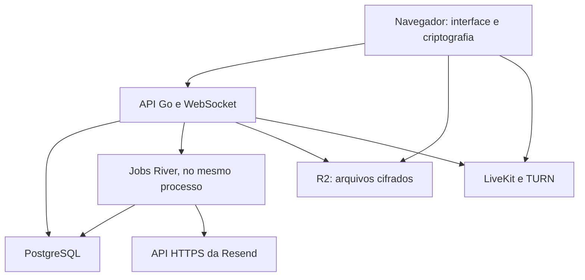

# ODDKIN — Especificação funcional e técnica

Versão: 0.3 — backend Go e e-mail via Resend • Data: 23 de outubro de 2026 • Idioma: português do Brasil

Status: especificação inicial para desenvolvimento. As decisões do usuário estão consolidadas; os padrões propostos abaixo são escolhas de implementação, não respostas adicionais atribuídas ao usuário. A arquitetura criptográfica exige prova de conceito e revisão antes do uso com dados reais.

## 1. Objetivo e limites do produto

Construir uma aplicação web interna para uma startup que desenvolve vários microSaaS simultaneamente. Centralizar planejamento, execução e comunicação em uma interface simples, inspirada no mockup ODDKIN fornecido. O aplicativo será desenvolvido com auxílio de IA; familiaridade prévia com uma linguagem não determina a stack.

O resultado deve permitir organizar projetos, épicos, atividades, subtarefas e sprints compartilhadas pela equipe; conversar em canais e mensagens diretas; compartilhar arquivos; e iniciar reuniões de até cinco pessoas com áudio, câmera e tela. A experiência deve transmitir personalidade com personagens pixelados e animações discretas, sem sistema de pontos.

O público inicial é uma única organização, com equipe interna e convidados externos. Capacidade-alvo: até dez pessoas simultaneamente na aplicação. Dez usuários é um alvo de validação, não um limite comercial de contas cadastradas. Cinco participantes por chamada é um limite rígido.

### 1.1 Decisões confirmadas na entrevista

| Tema | Decisão do usuário |
| --- | --- |
| Público | Equipe interna e convidados externos em projetos específicos |
| Visibilidade | Cada projeto tem seus membros; usuários só acessam projetos aos quais pertencem |
| Externos | Um conjunto granular de permissões por projeto, igual para todos os externos desse projeto, sem exceções por usuário |
| Organização | Épicos, atividades e subtarefas com responsável e prazo próprios |
| Responsabilidade | Um responsável principal por atividade ou subtarefa; outros podem acompanhar e comentar |
| Quadro | Colunas configuráveis por projeto |
| Sprint | Uma sprint da equipe pode reunir atividades de vários projetos |
| Encerramento | Escolher quais pendências vão para a próxima sprint e quais voltam ao backlog |
| Canais | Vários por projeto; acessíveis aos membros, respeitadas as permissões dos externos |
| Mensagens diretas | Conversas entre duas pessoas |
| Chat | Linear, com menções, reações por emoji e resposta citando mensagem |
| Reuniões | Pontuais, iniciadas com convite; até cinco participantes, com áudio, vídeo e compartilhamento de tela |
| Criptografia | Ponta a ponta para todo o conteúdo de trabalho, incluindo atividades, comentários e arquivos |
| Recuperação | Um administrador pode recuperar acesso, aceitando-se sua capacidade de descriptografar conteúdo |
| Login | E-mail e senha |
| Arquivos | Até 500 MB por arquivo, em chats ou atividades |
| Notificações | Apenas dentro do app: mensagens, menções, atribuições e chamadas |
| Mobile | Atividades e chat adaptados ao celular; chamadas focadas no desktop |
| Hospedagem | Projeto containerizado; VPS Contabo provisionada posteriormente pelo usuário |
| Storage | Cloudflare R2 |
| Animação | Personagens, transições e celebrações; sem pontos, níveis ou rankings |
| Backend | Go (Golang), conforme decisão posterior à entrevista inicial |
| E-mails transacionais | Envio pela API HTTPS da Resend, conforme decisão posterior |
| Distribuição | Projeto destinado a publicação open source; licença ainda a definir pelo mantenedor |
| Engenharia | TDD, quality gates e regras de contribuição em `CLAUDE.md`; nunca inserir `Co-authored-by` em commits |

### 1.2 Padrões propostos para completar a especificação

Estes padrões podem ser alterados sem reinterpretar as respostas da entrevista:

- Uma organização por instalação; sem cadastro público, planos, cobrança ou onboarding de empresas clientes.
- Nome de trabalho ODDKIN, baseado na referência visual. A marca pode ser trocada sem alterar o domínio.
- Interface PT-BR. Datas civis com fuso da organização; padrão inicial America/Campo_Grande. Eventos técnicos armazenados em UTC.
- Administração global, gestão de projeto e colaboração interna como papéis fixos. Matriz configurável apenas para externos, por projeto.
- Sprints com início e fim configuráveis, uma ativa por organização, abertura e encerramento manuais.
- Atividade pode existir sem épico e sem sprint. Subtarefa pertence obrigatoriamente a uma atividade e herda sua sprint.
- Prioridade simples: baixa, normal, alta e urgente. Sem estimativas, story points, dependências ou campos personalizados no MVP.
- Chamadas sem gravação, transcrição ou bots; até duas chamadas simultâneas como cenário de capacidade.
- Um compartilhamento de tela por chamada; câmera pode continuar ligada.
- Navegador de referência para chamadas e transferência de arquivos grandes: Chrome/Edge desktop atual e versão anterior. Compatibilidade adicional depende dos testes descritos adiante.
- Sem funcionamento offline completo. Cache local criptografado para retomada e sincronização; mutações de negócio exigem conexão.
- Sem notificações push, desktop ou e-mail de atividade. E-mails transacionais de conta e convite continuam necessários.
- Busca textual no cliente sobre conteúdo autorizado e sincronizado, sem índice de texto em claro no servidor.
- Arquivos conservados enquanto vinculados a conteúdo existente; exclusão e retenção operacional descritas na seção 15.

### 1.3 Fora do escopo inicial

Aplicativos nativos, múltiplas empresas na mesma instalação, faturamento, automações de workflow, integrações GitHub/GitLab, calendário externo, documentos colaborativos, edição simultânea de texto, gráficos de produtividade, time tracking, IA em execução dentro do app, reuniões agendadas, telefonia, salas de voz permanentes, grupos de DM, canais privados dentro de um projeto, threads, gravação e transcrição. O desenvolvimento com IA não implica incluir IA no produto.

## 2. Stack definida e justificativa

### 2.1 Composição

| Camada | Escolha | Motivo no contexto do produto |
| --- | --- | --- |
| Linguagens | Go no backend; TypeScript strict no frontend | Contratos gerados a partir de OpenAPI/JSON Schema; não compartilhar structs internas com a UI |
| Frontend | React + Vite, aplicação SPA | Aplicação autenticada e interativa, com descriptografia no navegador; renderização no servidor não é uma necessidade |
| Navegação e dados remotos | React Router + TanStack Query | Rotas, cache, paginação, atualização otimista controlada e invalidação após eventos |
| Interface | Tailwind CSS + componentes acessíveis baseados em Radix | Construir a linguagem visual do mockup mantendo semântica, foco e navegação por teclado |
| Movimento | Motion para React; CSS para sprites | Transições e celebrações sem introduzir um motor de jogos |
| Quadro | dnd-kit, com alternativa por teclado/menu | Reordenação e mudança de coluna com acessibilidade |
| Backend | Go + `net/http`, monólito modular | Um processo com API e jobs; composição explícita, contextos canceláveis e módulos de domínio |
| API | REST, OpenAPI 3.0.3, `oapi-codegen` e cliente TS gerado | Contrato primeiro; handlers Go estritos e validação runtime, sem GraphQL [S16] |
| Tempo real do produto | WebSocket padrão, `github.com/coder/websocket` | Eventos após persistência; mutações via REST; retomada por cursor e filas limitadas, conforme seção 14.4 [S10] |
| Banco | PostgreSQL | Integridade de relações, transações, políticas de acesso e histórico operacional |
| Acesso ao banco | `pgx/v5` + `sqlc`; migrations SQL com Goose | SQL explícito, queries tipadas geradas, locks e transações reais; sem ORM [S17–S19] |
| Jobs duráveis | River open source + PostgreSQL | Enqueue transacional com o mesmo `pgx.Tx`, retries e workers idempotentes; sem depender de recursos River Pro [S20] |
| Chamadas | LiveKit self-hosted; SDK oficial Go no backend; JS/React no navegador | Go gerencia salas/tokens e valida webhooks; mídia E2EE continua no LiveKit e no cliente [S1–S4, S15] |
| Conectividade de chamadas | TURN embutido do LiveKit | Conexão por retransmissão quando a rede do participante exigir [S2] |
| Redis | Não usado | LiveKit roda em nó único sem Redis; só será necessário se houver mais de um nó de mídia |
| Criptografia do conteúdo | libsodium.js / libsodium-wrappers-sumo, em Web Workers | Primitivas mantidas para criptografia autenticada, envelopes de chave e streaming [S5–S7] |
| Arquivos | R2 privado; AWS SDK for Go v2, cliente S3 e presigner no backend | Go emite URLs e conclui multipart; navegador envia ciphertext diretamente ao R2 [S8–S9, S23] |
| Sessões | Cookie opaco HttpOnly; sessão no banco | Revogação central, sem tokens de login persistidos em localStorage |
| Senhas | Argon2id via `golang.org/x/crypto/argon2` | Salt aleatório, parâmetros versionados e limites de custo; não usar como chave E2EE de login [S24] |
| E-mails transacionais | API HTTPS da Resend | Envio pelos jobs, após commit, com chave de idempotência estável, timeout e credencial apenas no servidor [S26–S27] |
| Testes | Go `testing`/`httptest`, `-race`, PostgreSQL real; Vitest e Playwright | TDD, concorrência, API real e interface; gates detalhados no `CLAUDE.md` |
| Empacotamento | Um módulo Go na raiz + pnpm workspace para frontend; Docker multi-stage e Compose | API/worker Go independentes do runtime Node; Node apenas no desenvolvimento/build do frontend |
| Entrada HTTPS | Caddy; roteamento L4 quando necessário para TURN/TLS | Certificados e proxy; portas e mídia exigem configuração específica |

### 2.2 Por que esta combinação

Go é a escolha definida para a API e os jobs. Usar biblioteca padrão HTTP, SQL explícito e módulos pequenos, com dependências injetadas por construtores. Evitar transportar padrões de decorators, containers de DI ou hierarquias de classes de frameworks de outras linguagens para Go.

React/TypeScript permanece no frontend, inclusive na criptografia e nos workers de arquivos. Go não descriptografa conteúdo E2EE, não processa mídia e não recebe o corpo dos anexos de 500 MB. LiveKit e R2 continuam como serviços especializados. A escolha da linguagem não elimina a necessidade de testar isolamento, distribuição de chaves, concorrência e revogação.

Contratos HTTP e de eventos passam a ser artefatos versionados independentes de linguagem. O frontend consome tipos/clientes gerados; a API não importa TypeScript nem mantém uma segunda implementação Node. Um único módulo Go permite compilar API, worker e ferramentas administrativas sem multiplicar serviços.

O chat persistente NÃO será o componente de chat transitório de uma sala LiveKit. Mensagens devem existir quando todos estão offline, independentemente da vida útil da chamada.

### 2.3 Versões e dependências

No início da implementação, selecionar versões estáveis e suportadas que passem juntas pela prova de conceito. Registrar Go/toolchain, dependências em `go.mod`/`go.sum`, geradores, ferramentas CI, Node/pnpm e lockfile JS, imagens e ADR de dependências. Não usar comandos `go install ...@latest` em CI. Não usar tags `latest` em produção. Validar o protocolo de criptografia e a compatibilidade do SDK LiveKit antes de atualizações.

A versão 0.3 desta spec fixa Go como backend e Resend como provedor de e-mails transacionais, sem afirmar que uma combinação específica de versões já foi testada. Não há benchmark executado como parte deste documento.

## 3. Arquitetura lógica

O navegador faz autenticação, sincroniza envelopes, descriptografa conteúdo autorizado e renderiza a interface. A API autentica e autoriza cada operação, mantém relações, aplica limites e persiste ciphertext. Os arquivos vão do navegador ao R2 já criptografados. A mídia vai ao LiveKit com E2EE ativada.

Os módulos de negócio pertencem a um único backend: Identity, Organizations, Projects, Authorization, WorkItems, Sprints, Conversations, Notifications, Attachments, Calls, KeyManagement e Audit. LiveKit é um serviço especializado separado. Não dividir o domínio em microserviços no MVP.

### 3.1 Estrutura esperada do repositório

| Diretório | Responsabilidade |
| --- | --- |
| `apps/web` | SPA, UI, sincronização, workers de criptografia e download |
| `cmd/api` | Composição e inicialização do servidor HTTP/WebSocket; sem regras de negócio |
| `cmd/migrate` | Opcional: as mesmas migrations (aplicação e River) executadas à mão. A API as aplica ao iniciar, sob lock consultivo |
| `internal/<dominio>` | Serviços, políticas, tipos e interfaces pequenas dos módulos de negócio |
| `internal/httpapi` | Adaptadores HTTP, middleware e código OpenAPI gerado |
| `internal/realtime` | Conexões WebSocket, entrega e retomada; sem escrita de negócio por socket |
| `internal/platform` | Configuração, banco, LiveKit, R2, Resend, logs e relógio |
| `internal/store/sqlc` | Acesso SQL gerado; não editar manualmente |
| `db/migrations` e `db/queries` | Migrations Goose e queries de entrada do sqlc |
| `api/openapi.yaml` | Contrato REST 3.0.3, fonte dos DTOs/handlers e do cliente TS |
| `api/events` | JSON Schemas versionados dos eventos e controle de socket |
| `packages/api-client` | Tipos e cliente TypeScript gerados do OpenAPI |
| `packages/contracts` | Tipos/validadores de eventos gerados dos schemas; sem lógica backend |
| `tests/integration` e `tests/e2e` | Cenários reais de concorrência, integração e UI |
| `packages/crypto-client` | Formatos versionados e integração das primitivas no navegador |
| `packages/ui` | Componentes visuais e tokens |
| `infra` | Dockerfiles, Compose, proxy, LiveKit e exemplos de configuração |
| `docs` | ADRs, matriz de permissões, protocolo de chaves, operação e recuperação |

### 3.2 Regras de implementação Go

Fluxo de uma mutação: handler decodifica/valida o contrato → serviço autoriza e executa a regra → repositório/queries participam de uma transação → resposta é enviada após commit. Handlers não fazem SQL, workers não duplicam regras e código gerado não contém lógica de autorização.

- Um `go.mod` na raiz; comandos em `cmd/` são entrypoints pequenos. Construtores recebem banco, integradores, relógio e gerador de IDs quando necessário. Não usar estado global mutável nem service locator.
- `context.Context` é o primeiro argumento de operações com I/O. Propagar cancelamento e prazo do request a SQL, R2, LiveKit e Resend. Definir timeouts por integração; não usar cliente HTTP sem timeout.
- Toda goroutine tem proprietário, condição de encerramento e cancelamento. Filas, pools e fan-out têm limites. Não disparar goroutine por destinatário sem controle.
- Persistência de trabalhos assíncronos vai para River/outbox. Goroutine solta após responder HTTP não é job durável.
- Erros de domínio têm códigos estáveis, sem detalhes SQL/secrets; mapear para HTTP numa única borda. Usar `errors.Is/As` e wrapping com contexto seguro; `panic` não é fluxo de erro de negócio.
- Queries parametrizadas. DTOs HTTP, tipos de domínio e linhas SQL são distintos. `NULL`, zero e ausência não são intercambiáveis; PATCH deve distinguir campo omitido, valor e remoção explícita.
- UUID e bytes cifrados possuem validação de formato. No JSON, ciphertext/nonce/assinatura usam base64 com convenção única; campos `int64` que podem exceder a precisão JS são strings decimais.
- HTTP configura limites de corpo, cabeçalhos, duração e requests por usuário. Padrão inicial: corpo JSON até 2 MiB; limites menores por endpoint. Arquivos grandes nunca passam pelo handler.
- Sessões e autorização permanecem server-side. Middleware autentica; serviço revalida a permissão atual dentro da operação crítica. Não confiar em role fornecida pelo cliente ou em cache sem invalidação.
- Usar `slog` estruturado com allowlist de campos seguros. Não serializar request/response por conveniência.
- Servidor normal começa com `ReadHeaderTimeout` de 5 s e limites de headers; deadlines de HTTP comum e de WebSocket são configurados separadamente. Ajustar por teste, sem timeout infinito acidental.
- Ao receber SIGTERM: retirar readiness, parar novas admissões, fechar sockets com indicação de retomada, drenar HTTP, parar River e fechar pools. Usar prazo total explícito de 30 s inicialmente; testar saída com jobs e requests ativos.

### 3.3 SQL, transações e jobs

`sqlc` gera queries para `pgx/v5` a partir de SQL mantido em `db/queries`. A IA escreve e testa as queries originais, executa geração e commita ambos. Não editar arquivos gerados nem inserir SQL concorrente improvisado no handler.

O serviço coordena `pgx.Tx`; todos os repositórios envolvidos usam a mesma transação, inclusive River `InsertTx` quando aplicável. Negócio, idempotência e outbox entram no mesmo commit. Nunca chamar LiveKit, Resend ou R2 segurando locks do banco: preparar intenção, chamar serviço externo com timeout e reconciliar o resultado de forma idempotente.

Mutações concorrentes de sprint, quota e admissão de chamada exigem constraints e locks PostgreSQL. Mutex em Go não protege outra instância nem reinício. Usar ordem determinística de locks, limites de retry de deadlock/serialização e idempotency key. Versionamento otimista continua obrigatório para edição do mesmo item.

Goose gerencia migrations SQL do app; River mantém as próprias migrations por seu mecanismo oficial. `cmd/migrate` orquestra ambos em ordem documentada e sem API concorrendo para migrar. Não modificar migration já aplicada; nova mudança gera nova migration. Implantação deve aceitar rollback de binário quando possível com migrations expand/contract; reversão destrutiva de dados não é automática.

Jobs contêm IDs e referências, nunca conteúdo descriptografado ou chave de recuperação. Fixar attempts/backoff e timeout por tipo. O worker usa a chave da API da Resend, injetada somente no servidor; o payload não inclui segredos de trabalho. A chave de idempotência da Resend expira após 24 horas: manter estado durável local de envio e reconciliação para impedir reenvio tardio. Entrega at-least-once não equivale a execução exatamente uma vez. Usar somente o núcleo open source do River; não depender de funcionalidade paga para cumprir esta spec.

## 4. Identidade, convites e sessões

### 4.1 Entrada e convite

- Não permitir cadastro público. Um administrador convida um usuário para a organização e/ou um gestor o convida para um projeto.
- O convite referencia o e-mail normalizado, o projeto e o vínculo interno/externo. Token aleatório, armazenado como hash, de uso único e expiração proposta de sete dias.
- Aceitar convite exige comprovar controle do e-mail. Para conta existente, o e-mail da sessão deve corresponder ao destinatário.
- Uma conta pode pertencer a vários projetos e receber convites sucessivos sem duplicação.
- O papel global interno/externo é determinado pela organização. Gestor de projeto não promove externo a interno.
- Login exige e-mail e senha. Proposta: mínimo de 12 caracteres, aceitando frases longas, gerenciadores e colagem, sem regras arbitrárias de composição.
- Respostas de login, recuperação e convite não devem permitir enumerar contas.

### 4.2 Ciclo da sessão

- Cookie `Secure`, `HttpOnly`, `SameSite=Lax`, com sessão opaca. Armazenar apenas hash do token de sessão no banco.
- Prazo proposto: expiração absoluta de sete dias e por inatividade de 24 horas; atualização controlada da atividade.
- Proteção CSRF nas mutações por cookie, validação de Origin e política CORS restrita.
- Login limitado por IP e conta; aplicar limitação progressiva e não travar indefinidamente a conta por ações de terceiros.
- Tela de dispositivos/sessões, logout atual e logout de todas as sessões. Desativar conta revoga todas as sessões.
- WebSocket usa a mesma identidade, valida origem e sessão no handshake e revalida autorização para cada operação.
- Reset de senha usa token único de curta duração, invalida sessões anteriores e não restaura por si só chaves criptográficas.
- Autenticado e apto a descriptografar são estados diferentes: dispositivo novo pode entrar na conta e permanecer aguardando autorização criptográfica.

### 4.3 E-mails transacionais

Necessários para convite, verificação e redefinição de senha. Enviar pelo endpoint `POST /emails` da API HTTPS da Resend, com autenticação Bearer, remetente de domínio verificado e chave de idempotência estável por intenção de envio. Configurar `RESEND_API_KEY` e `RESEND_FROM_EMAIL` apenas nos processos de envio do servidor, sem expor credenciais ao navegador, ao código-fonte ou aos logs. Em desenvolvimento e testes, usar servidor HTTP local que simula o contrato da Resend; o comando diagnóstico `cmd/email-smoke` permite ao operador validar um envio real com credenciais e domínio configurados. E-mails não devem incluir títulos de projetos, mensagens, tarefas ou prazos descriptografados. Não enviar resumos, lembretes ou notificações de atividades por e-mail. A resposta da API confirma aceitação pelo provedor, não entrega na caixa postal; falhas e webhooks de entrega exigem reconciliação.

## 5. Projetos, membros e autorização

### 5.1 Papéis propostos

| Papel | Escopo e responsabilidade |
| --- | --- |
| Administrador da organização | Contas, criação de projetos, nomeação de gestores, sprints globais e operações administrativas |
| Gestor do projeto | Configurações, membros, colunas, canais e permissões dos externos daquele projeto |
| Membro interno | Colaboração nos projetos aos quais pertence |
| Externo | Ações determinadas exclusivamente pelo perfil compartilhado de externos do projeto |
| Administrador de recuperação | Capacidade criptográfica especial; exercida com chave local e registrada em auditoria |

Administrador global não ganha automaticamente a navegação cotidiana de todos os conteúdos. Pode gerenciar a estrutura organizacional e iniciar ações administrativas auditadas. Conteúdo de projeto exige vínculo, exceto o fluxo explícito de recuperação autorizado pelo modelo de confiança. A capacidade de recuperação é uma exceção consciente ao isolamento de conteúdo, não uma promessa de privacidade contra esse administrador.

Administrador de recuperação pode coincidir com o administrador da organização, mas a credencial criptográfica é separada do login. Externos não administram organização, recuperação, projetos ou membros.

### 5.2 Perfil granular único de externos

Uma linha de política por projeto, versionada. Todos os vínculos externos daquele projeto apontam para essa política; não existe tabela de override por pessoa. A mudança vale para todos imediatamente no servidor.

| Permissão | Alcance | Padrão inicial proposto |
| --- | --- | --- |
| `work.read` | Ver épicos, atividades, subtarefas e seus comentários | Sim |
| `work.create` | Criar atividades/subtarefas; épicos exigem edição de planejamento | Não |
| `work.edit` | Editar campos, responsável e prazo | Não |
| `work.move` | Mover entre colunas e concluir/reabrir | Não |
| `work.archive` | Arquivar e restaurar itens | Não |
| `work.comment` | Comentar e acompanhar atividades | Sim |
| `planning.edit` | Gerenciar épicos e vincular atividades a sprints já existentes | Não |
| `chat.read` | Ler todos os canais do projeto | Sim |
| `chat.send` | Enviar, citar e mencionar em canais | Sim |
| `chat.react` | Reagir e remover a própria reação | Sim |
| `files.upload` | Enviar arquivos no contexto autorizado | Sim |
| `files.download` | Obter e descriptografar arquivos de contextos autorizados | Sim |
| `calls.start` | Iniciar chamada vinculada ao projeto | Não |
| `calls.join` | Aceitar convite e participar | Sim |
| `calls.screen_share` | Compartilhar tela na chamada | Não |
| `direct_messages.use` | Iniciar/usar DM com pessoas do mesmo projeto | Sim |

Dependências: editar/mover/comentar exige leitura; enviar/reagir em canal exige leitura do chat; upload exige poder escrever no contexto e baixar arquivos; iniciar chamada exige participar. Configurações inválidas são rejeitadas, com explicação. Permissões de comentários e mensagens não concedem alteração de mensagens/comentários de outras pessoas.

Os padrões da tabela são propostas conservadoras; o gestor pode habilitar colaboração completa. No formulário, agrupar permissões por Atividades, Conversas, Arquivos e Chamadas. Mostrar que a alteração afeta todos os externos do projeto.

### 5.3 Regras obrigatórias de acesso

- Toda busca, listagem, contagem, anexo, evento e chamada deve filtrar por autorização antes de retornar dados.
- Identificadores imprevisíveis não substituem autorização. A API deve testar o vínculo mesmo para recursos acessados diretamente por URL.
- Canais não têm ACL própria no MVP: todos os membros com `chat.read` acessam todos os canais do projeto.
- Um evento da sprint global nunca transmite nomes, identificadores ou totais de projetos que o destinatário não pode acessar.
- Revogação desconecta subscriptions, bloqueia emissão de URLs/tokens e inicia rotação das chaves dos domínios afetados.
- Arquivos e chaves já copiados por um usuário não podem ser apagados remotamente. A revogação bloqueia novos acessos e conteúdo futuro; não desfaz leitura anterior.
- Direitos de edição são aplicados pela API mesmo quando vários participantes possuem uma chave simétrica para leitura.

## 6. Planejamento e atividades

### 6.1 Projetos

Campos de conteúdo: nome, descrição, cor e ícone. Campos operacionais: ID, organização, estado ativo/arquivado, membros e versão. Arquivar remove o projeto das listas padrão, mantém histórico em leitura e bloqueia novas atividades, mensagens, uploads e chamadas; as mensagens diretas seguem a regra de contexto da seção 8.

Criar projeto gera canais `geral` e um quadro inicial com A fazer, Em andamento, Em revisão e Concluído. São padrões editáveis, não estados fixos impostos ao usuário.

### 6.2 Hierarquia

- Épico pertence a exatamente um projeto. Pode reunir várias atividades e atravessar sprints.
- Atividade pertence a exatamente um projeto, pode ter um épico e no máximo uma sprint corrente.
- Subtarefa pertence a exatamente uma atividade do mesmo projeto. Não criar níveis adicionais.
- Subtarefa herda a sprint da atividade, mas possui responsável, prazo e estado próprios.
- Épico pode ter responsável, prazo e estado aberto/concluído; progresso é derivado dos filhos acessíveis.
- Não mover itens entre projetos no MVP, pois isso altera autorização e domínios criptográficos.

### 6.3 Campos de trabalho

| Campo | Regra |
| --- | --- |
| Título | Obrigatório; até 200 caracteres; criptografado |
| Descrição | Markdown limitado e sanitizado; até 50 mil caracteres; criptografado |
| Responsável | Zero ou um membro ativo do projeto; interno ou externo com leitura do item |
| Prazo | Data civil opcional `YYYY-MM-DD`, independente para épico, atividade e subtarefa; criptografada |
| Prioridade | Baixa, normal, alta, urgente; padrão normal; criptografada |
| Estado | Referência à coluna do projeto; metadado operacional |
| Épico e pai | Referências relacionais validadas no servidor |
| Sprint | Opcional na atividade; herdada pela subtarefa |
| Seguidores | Membros com acesso que recebem eventos relevantes dentro do app |
| Comentários | Fluxo cronológico, texto criptografado e anexos opcionais |
| Anexos | Objetos cifrados, vinculados ao recurso e sujeitos a acesso específico |
| Histórico | Autor, ação, data técnica, versão; valores textuais antigos não ficam em claro |

Remover membro responsável deixa o item sem responsável, preservando a identificação histórica do evento. Não transferir silenciosamente para o gestor.

### 6.4 Colunas configuráveis

Cada coluna possui ID, nome criptografado, posição e categoria operacional: `todo`, `in_progress` ou `done`. A categoria permite reconhecer conclusão sem depender do texto escolhido pelo usuário. A coluna Em revisão, por exemplo, pode ser da categoria `in_progress`.

Manter ao menos uma coluna aberta e uma `done`. Permitir várias colunas na mesma categoria. Ao excluir coluna ocupada, exigir coluna de destino; executar a movimentação em transação. Mudar uma categoria exige apresentar o impacto e não deve disparar celebrações individuais em massa.

O quadro mostra atividades no primeiro nível, com progresso das subtarefas; subtarefas são acessadas no detalhe e em lista expansível. Não duplicar o mesmo trabalho como cartões independentes em várias colunas.

### 6.5 Regras de conclusão e concorrência

- Mover atividade com subtarefas abertas para `done` oferece concluir todas ou cancelar. Não deixar estado implicitamente inconsistente.
- Concluir a última subtarefa não conclui automaticamente a atividade; oferecer ação explícita.
- Reabrir subtarefa de atividade concluída reabre a atividade na primeira coluna `in_progress`, ou na primeira aberta se não houver tal categoria. Notificar sobre a mudança.
- Épico só é concluído quando todas as atividades não arquivadas estão concluídas. A operação é explícita; reabrir uma atividade reabre o épico concluído.
- Usar versão do registro para impedir perda silenciosa de edição. Conflito retorna `409` e permite comparar/recarregar no cliente.
- Transações validam projeto, hierarquia, coluna, sprint, responsável e permissões no mesmo commit.
- Textos e prazos cifrados são validados semanticamente no cliente. O servidor valida formato, tamanho, versão, assinatura e relações, sem alegar validar um texto que não consegue ler.

### 6.6 Visões

Visão geral mostra apenas projetos acessíveis, sprint ativa, itens atribuídos ao usuário e prazos próximos. Atividades oferecem quadro e lista; filtros por projeto, épico, responsável, estado, sprint, prioridade e prazo. Filtros de conteúdo cifrado são executados no navegador depois da sincronização autorizada.

Buscar título/descrição localmente. Exibir claramente o intervalo sincronizado; não mostrar “nenhum resultado” como se todo o histórico já tivesse sido pesquisado quando ainda não foi carregado. Não enviar termos de busca descriptografados à API.

## 7. Sprints da equipe

### 7.1 Modelo e visibilidade

Sprint pertence à organização e pode conter atividades de diferentes projetos. Estados: planejada, ativa e encerrada. Proposta: uma ativa por vez. Nome, objetivo e datas de planejamento são conteúdo criptografado; ID, estado e referências de associação são metadados operacionais.

Cada usuário recebe apenas a projeção autorizada da sprint. Externo vê a sprint quando há trabalho de um projeto seu e a política permite ler atividades. Não informar “3 projetos ocultos” ou totais globais. O nome e o objetivo da sprint são compartilhados com seus participantes autorizados; não devem conter segredos de um projeto inacessível. Textos específicos ficam nas atividades do projeto.

Administradores que planejam a sprint precisam de acesso explícito aos projetos envolvidos para operar o planejamento completo. Se não houver acesso a todos os projetos com pendências, o fechamento deve ser bloqueado com indicação administrativa genérica, sem revelar conteúdos.

### 7.2 Planejar e iniciar

Informar nome, objetivo opcional, início e fim; início não pode ser posterior ao fim. Datas são civis e interpretadas no fuso configurado. Datas orientam a interface, não iniciam ou encerram a sprint por cron no servidor.

Adicionar atividade move também suas subtarefas. Épico continua independente da sprint. Não permitir que a mesma atividade esteja em duas sprints correntes. Backlog significa atividade sem sprint corrente.

### 7.3 Encerrar

1. Abrir resumo com concluídas e pendências acessíveis.
2. Selecionar uma sprint planejada de destino ou criar uma, se houver permissão.
3. Para cada pendência, escolher próxima sprint ou backlog. Não permitir pendências sem destino.
4. Revisar e confirmar. A API valida a lista completa de IDs pendentes e suas versões; nunca aceita uma lista parcial inadvertida.
5. Em transação, registrar o resultado histórico, atualizar associações correntes e encerrar a sprint.
6. Publicar eventos pós-commit e apresentar celebração breve, respeitando redução de movimento.

Se outra pessoa alterar uma pendência durante a revisão, retornar conflito e atualizar o resumo; não descartar a edição. Manter `SprintItemHistory` para que mover ao backlog não apague a participação passada. Encerrar sprint não altera prazos automaticamente.

## 8. Conversas e comentários

### 8.1 Canais do projeto

Gestor cria, renomeia, ordena e arquiva canais. Canal arquivado fica somente leitura. Nome e descrição são cifrados; ID, projeto, estado e timestamps técnicos ficam disponíveis ao servidor. Sem canais privados ou permissões por canal.

### 8.2 Mensagens diretas

Uma DM tem exatamente duas pessoas e uma identidade canônica para o par, sem duplicação. Para iniciar ou continuar uma conversa, deve existir ao menos um projeto ativo compartilhado que autorize DM para os externos envolvidos. Internos também seguem esta regra de projeto compartilhado, preservando o isolamento acordado.

Se o par compartilhar vários projetos, basta um contexto ativo elegível. A permissão de DM não muda por pessoa: decorre da política dos projetos compartilhados. Ao perder todos os contextos elegíveis, bloquear envio e acesso futuro via servidor, mantendo cópias já existentes fora do alcance de revogação. Esse comportamento é um padrão proposto e deve aparecer nas configurações de política.

Contatos sugeridos devem derivar de projetos compartilhados. Não expor diretório global a externos. Chamadas de grupo são iniciadas em canais de projeto; chamadas de DM têm os dois interlocutores. Para reunir mais pessoas, iniciar pelo projeto, sem transformar a DM em grupo.

### 8.3 Mensagens

- Texto com até 10 mil caracteres, markdown limitado, anexos, menções a usuários do contexto e resposta por referência a uma mensagem da mesma conversa.
- Sem threads. A resposta aparece na sequência e mostra trecho da mensagem citada após descriptografia autorizada.
- Reações por emoji; uma reação de cada tipo por pessoa, alternável. O emoji é conteúdo cifrado. IDs opacos permitem sincronização sem persistir o emoji em claro.
- Editar e apagar apenas mensagens próprias, sem janela temporal no MVP. Exibir marcador de edição; exclusão produz tombstone, sem prévia citada residual.
- Gestor pode moderar canal removendo mensagens; administrador global não recebe automaticamente leitura de DMs.
- Não persistir cópia em claro do trecho citado. Se a original foi removida ou ficou inacessível, mostrar “Mensagem indisponível”.
- Não incluir preview automático de URLs, embeds remotos ou download pelo servidor de links enviados.
- Estado visual: enviando, enviado ou falhou; retry idempotente. “Enviado” significa persistido, não lido pelo destinatário.
- Sem recibos individuais de leitura na interface do MVP. Manter cursor de leitura para calcular não lidas.
- Mensagens e comentários usam paginação por cursor; carregamento inicial proposto de 50 registros.
- Em caso de perda de conexão, rascunho permanece local protegido e a UI informa falha. Não prometer envio offline.

### 8.4 Persistência e entrega

A mutação recebe `clientMutationId` único por autor. Inserir conteúdo e evento de outbox na mesma transação. Só emitir confirmação definitiva após commit. Consumidor pode entregar eventos mais de uma vez; clientes eliminam duplicatas por `eventId` e versão. Reconexão recupera cursor autorizado da API, sem depender de mensagens mantidas em memória pelo gateway.

Notificações de menção usam IDs de destinatários como metadados validados no contexto. O conteúdo literal permanece cifrado. Não permitir mencionar usuários sem acesso para induzir vazamento.

## 9. Chamadas de áudio, vídeo e tela

### 9.1 Experiência

Botão “Iniciar chamada” em canal e em DM elegível. Abrir prévia de câmera/microfone, permitir selecionar dispositivos e entrar sem câmera. Quem inicia seleciona destinatários elegíveis; convite aparece dentro do app. Pessoas offline não recebem push ou e-mail.

Aceitar, recusar, cancelar convite, mutar/desmutar, ativar câmera, trocar dispositivos, compartilhar/parar tela, sair e encerrar para todos são ações explícitas. Gestor do projeto e iniciador podem encerrar a chamada do canal; em DM qualquer participante pode sair e a sala fecha ao ficar vazia.

Exibir participantes, estado de conexão e indicador de fala. Um usuário só ocupa uma vaga por chamada; entrada em outro dispositivo exige transferir a participação. Uma pessoa não participa de duas chamadas simultaneamente no produto.

### 9.2 Limite de cinco

O limite vale para pessoas simultaneamente admitidas, incluindo o iniciador. Não depender de botão desabilitado no frontend.

Implementar reserva atômica no backend, com expiração proposta de 30 segundos, vínculo a usuário/sessão/chamada e transação sob lock. Configurar o limite de sala do LiveKit também. Uma reserva desconectada pode ser renovada para reconexão sem criar sexto participante. Tokens curtos e restritos à sala/identidade; nunca conceder a clientes permissão de criar salas arbitrárias.

Quando a sala lotar, rejeitar a sexta admissão antes de fornecer credenciais válidas, exibindo “Esta chamada já tem 5 participantes”. Testar seis entradas concorrentes, dois dispositivos da mesma conta, expiração de reserva e reuso de tokens. Validar a semântica do limite da versão fixada do LiveKit; não presumir que configuração isolada basta.

### 9.3 Mídia e chaves

- Câmera com alvo inicial de até 720p/30 fps, ajustando pela conexão. Tela até 1080p/15 fps como padrão proposto para legibilidade; não prometer qualidade fixa.
- Um compartilhamento ativo por chamada, arbitrado no backend; permissão de publicação correspondente no LiveKit. Troca explícita de apresentador.
- Áudio, câmera e tela com E2EE ativa antes da publicação. Navegador incompatível recebe mensagem de incompatibilidade; nunca cair silenciosamente para chamada sem E2EE.
- Chave efêmera de chamada gerada no cliente e distribuída em envelopes para os dispositivos admitidos. Backend não recebe chave de mídia em claro.
- Rotacionar chave ao mudar participantes, especialmente após expulsão ou revogação. Bloquear publicação enquanto uma rotação necessária não foi confirmada; definir comportamento de reconexão no ADR.
- Não usar a chave persistente do projeto como chave de mídia. Não colocar chave em JWT, URL, metadata LiveKit ou log.
- Não gravar mídia. Recuperação administrativa de conteúdo persistido não significa recuperar chamadas passadas que nunca foram gravadas.
- Webhooks LiveKit validados, idempotentes e usados para reconciliar presença. Executar também reconciliação periódica, pois webhook pode atrasar ou falhar.
- Após todos saírem, encerrar sala e remover material efêmero segundo expiração. Guardar apenas auditoria mínima de participação e duração.

### 9.4 Infraestrutura de mídia

LiveKit self-hosted usa WebRTC/SFU, com TURN configurado. HTTPS/WebSocket e portas de mídia são caminhos diferentes. A mídia não passa por R2 nem deve ser presumida compatível com o proxy HTTP comum da Cloudflare. Usar DNS e regras de rede adequados para o endereço de mídia [S2–S4].

TURN/TLS em 443 pode disputar a porta do HTTPS no mesmo IP. Entregar uma configuração validada de roteamento L4 por SNI para hostnames distintos, ou documentar como alternativa um segundo IP/host de TURN. Não entregar dois containers tentando publicar a mesma porta. UDP e TCP também exigem regras explícitas. A seleção final do VPS permanece com o usuário.

## 10. Criptografia e recuperação administrativa

### 10.1 Modelo de confiança

Objetivo: conteúdo legível somente nos clientes autorizados e no procedimento de recuperação administrativa. Uma cópia de PostgreSQL, R2, Redis ou backup não deve conter chaves suficientes para descriptografar o conteúdo de trabalho.

O administrador de recuperação é parte confiável e pode recuperar conteúdo, inclusive DMs. Não apresentar o produto como privado contra esse administrador. A operação de recuperação deve ser explícita e auditável, sem disponibilizar uma rota administrativa de download de plaintext.

E2EE não oculta todos os metadados. A aplicação web também depende da integridade do código entregue ao navegador: um servidor comprometido que sirva JavaScript malicioso pode capturar plaintext no cliente. CSP, builds controlados e revisão de dependências reduzem exposição; não eliminam esse limite do modelo web.

### 10.2 Conteúdo versus metadados

| Dado | Tratamento proposto |
| --- | --- |
| Títulos, descrições, textos, comentários, nomes de canais/projetos e arquivos | E2EE |
| Prazo, prioridade, objetivos e datas planejadas de sprint | E2EE; cálculo e filtros no cliente |
| Conteúdo binário de anexos, thumbnails e manifesto de arquivo | E2EE antes do upload |
| Emojis e texto de respostas | E2EE |
| Áudio, vídeo e tela | E2EE de mídia via SDK LiveKit |
| E-mail, nome de perfil e estado da conta | Dados de identidade acessíveis ao backend, protegidos em trânsito e pelo armazenamento/backup |
| IDs, membros, papéis, permissões, autor, responsável, relações de pais/filhos, coluna/categoria e vínculos de sprint | Metadados necessários a acesso, integridade e sincronização, visíveis ao backend |
| Horários técnicos, ordem, tamanho aproximado, cursores, destinatários de menção e presença | Metadados visíveis ao backend; retenção mínima |
| Segredos de infraestrutura | Disponíveis apenas aos serviços que os utilizam; separados das chaves E2EE |

A distinção acima é uma proposta explícita de implementação do requisito “todo o conteúdo”. Se também for necessário esconder responsável, estado ou estrutura do trabalho do servidor, revisar o modelo: várias validações e filtros terão de mudar. Não chamar proteção de disco ou TLS de E2EE.

### 10.3 Domínios de chave e permissões

Não usar uma única chave global. Separar ao menos planejamento/tarefas do projeto, chat do projeto, sprint compartilhada, DM, arquivos individuais e chamadas efêmeras. A chave de um domínio só é entregue a dispositivos de usuários que podem ler esse domínio.

Como arquivos podem ter download desabilitado para externos que leem atividades, a chave do arquivo NÃO pode ser incluída dentro de um payload de tarefa legível por esses externos. Usar envelopes próprios por arquivo e destinatário autorizado. Mesma regra para qualquer futura permissão de leitura independente.

Um domínio persistente usa gerações de chave (`keyVersion`). Mudança de membros/permissões exige rotação do domínio afetado. Novas mensagens e revisões só podem usar a geração atual; o servidor rejeita escritas em geração antiga. Usuários atuais mantêm acesso às gerações históricas autorizadas. Conceder acesso a novo membro inclui histórico do projeto por padrão, após redistribuição no cliente autorizado.

Rotação e concessão de histórico precisam de um cliente autorizado online: o servidor não conhece a chave a redistribuir. Ao revogar, a API primeiro bloqueia acesso e marca o domínio como `rotation_required`; nenhuma nova escrita cifrada naquele domínio é aceita até um cliente elegível publicar a nova geração e os envelopes para o conjunto atual de destinatários. A confirmação usa a versão da política/lista de membros sob transação; se ela mudou, refazer a operação. Um membro recém-convidado pode ficar em `pending_keys` até a distribuição ocorrer, sem receber conteúdo ilegível como se o acesso estivesse concluído. Não rotacionar silenciosamente no backend nem continuar escrevendo com a chave que o removido já conhece.

Para recuperação histórica, manter no cliente autorizado ou no envelope administrativo acesso às gerações necessárias. Rotacionar apenas a chave de mensagens futuras não recifra automaticamente arquivos antigos. Arquivos cujo acesso futuro precise ser retirado de alguém que já possuía a chave exigiriam nova criptografia e substituição do objeto; ainda assim, cópias anteriores não são revogáveis. O MVP bloqueia acesso via serviço e protege versões futuras, sem prometer apagamento criptográfico retroativo.

### 10.4 Primitivas e envelopes

Usar criptografia autenticada, geração aleatória criptograficamente segura, formatos versionados e bibliotecas mantidas. Proposta para prova de conceito: XChaCha20-Poly1305 para pequenos payloads, sealed boxes para encapsular chaves e secretstream para arquivos. Sealed boxes não autenticam a identidade do remetente; envelopes e alterações do diretório de chaves precisam também de assinatura e validação de autoridade [S5–S7].

O envelope deve identificar versão de protocolo, recurso, domínio, geração de chave, revisão, nonce quando aplicável, ciphertext e assinatura. Associar organização, projeto/conversa, recurso, autor e revisão como contexto autenticado. O cliente deve detectar troca de ciphertext entre registros ou projetos. Nunca reutilizar nonce com a mesma chave em APIs que exigem nonce explícito.

A autenticidade da lista de dispositivos deve ser vinculada a uma raiz de confiança administrativa verificada fora do banco, com certificados assinados e fingerprint fixado no cliente. O backend não pode adicionar silenciosamente uma chave própria como “novo dispositivo”. Mudanças inesperadas de identidade exigem verificação. A inscrição inicial e a proteção contra substituição de chave precisam ser especificadas no ADR e testadas antes da liberação.

Não prometer forward secrecy ou post-compromise security de um protocolo de mensageria completo com esse desenho inicial. Rotação por membros e envelopes versionados não equivalem a essas garantias. O protocolo de envelopes da aplicação precisa de revisão; usar libsodium não certifica automaticamente o sistema inteiro.

### 10.5 Dispositivos e login

Login não entrega chaves privadas em claro. Cada dispositivo gera material local e é autorizado por um dispositivo já confiável ou pelo administrador de recuperação. Persistir material privado apenas protegido localmente; chaves em memória são descartadas ao bloquear/sair e nunca entram em logs, analytics ou estado global de UI serializado.

Não derivar o desbloqueio E2EE diretamente da mesma senha enviada ao backend no login convencional: isso permitiria ao backend derivar o segredo. A proposta utiliza autorização de dispositivo, proteção local e recuperação administrativa separada. Novos dispositivos mostram “Aguardando liberação do histórico” até concluir o vínculo.

Logout apaga plaintext e cache de sessão; dados locais persistentes devem continuar cifrados. Dispositivo revogado não recebe novos envelopes e perde sessões e subscriptions. Não afirmar que revogação torna ilegíveis dados já copiados.

### 10.6 Recuperação

1. Na configuração inicial, o administrador gera uma identidade de recuperação no cliente. Exporta backup protegido por segredo forte separado da senha de login e guarda fora do VPS/R2 operacional.
2. Cada identidade ou domínio recuperável mantém envelope destinado à chave pública de recuperação. O servidor pode armazenar esse envelope, jamais a chave privada em claro.
3. A pessoa recupera sua conta por e-mail e solicita autorização para um dispositivo novo.
4. Administrador verifica a identidade e aprova a solicitação em dispositivo confiável. Desbloqueia localmente o material de recuperação.
5. Reencapsular as chaves necessárias para a nova identidade/dispositivo e assinar a autorização. O servidor transporta apenas envelopes.
6. Registrar solicitante, aprovador, escopo, horário e resultado; notificar dentro do app. Revogar dispositivos perdidos e rotacionar domínios conforme o risco.

Reset de senha e recuperação criptográfica são operações distintas. Perda de todos os dispositivos e também do segredo de recuperação pode tornar o histórico irrecuperável; não criar chave-mestra oculta no servidor. Trocar o administrador de recuperação exige reencapsular material existente antes de aposentar a chave antiga.

### 10.7 Consequências de produto

Busca, previews e filtros de conteúdo são locais. Jobs não leem tarefas, não indexam descrições e não montam e-mails com conteúdo. Contadores e notificações podem usar apenas metadados autorizados. Não há antivírus ou thumbnail de plaintext no servidor. Prévia de imagem deve ser gerada e cifrada no cliente; arquivos executáveis e documentos não são executados automaticamente.

Em dispositivos bloqueados, exibir mensagens genéricas em notificações. Não inserir textos de atividade em URLs, título do navegador, logs de erro ou breadcrumbs de telemetria.

## 11. Arquivos de até 500 MB

### 11.1 Limites e fluxo

Definir 500 MB como 500.000.000 bytes de arquivo original. Aceitar esse tamanho exato; rejeitar 500.000.001 bytes. O ciphertext terá overhead calculado pelo formato e deve ter limite correspondente, não ser cortado no mesmo teto de plaintext.

1. Cliente valida tamanho e contexto. API autoriza, reserva capacidade e cria sessão de upload e chave de objeto aleatória.
2. Cliente gera chave exclusiva do arquivo e cifra incrementalmente em worker. Não usar `arrayBuffer()` sobre o arquivo inteiro.
3. Para arquivos grandes, usar multipart direto ao R2 com URLs assinadas curtas por parte. Usar partes agregadas compatíveis com os limites do R2; proposta inicial de aproximadamente 8 MiB de ciphertext, com no máximo duas em trânsito [S8–S9].
4. Manter registros criptográficos sequenciais de tamanho menor dentro das partes. Multipart de transporte não é o mesmo que o formato criptográfico.
5. Retransmitir bytes cifrados idênticos da parte que falhou; não reutilizar nonce de forma incorreta nem misturar partes de outra tentativa.
6. Ao finalizar, API consulta partes/tamanho real e valida reserva, vínculo, manifesto e metadados operacionais. Completar objeto apenas dentro dos limites e marcar anexo pronto atomicamente.
7. Descartar uploads inválidos e liberar reserva; anexos incompletos nunca aparecem como disponíveis.

O cliente deve vincular o manifesto cifrado ao identificador do upload, comprimento original, esquema de registros, total de registros e marca de finalização. Leitor detecta truncamento, alteração, troca e reordenação. O backend não consegue provar a semântica do tamanho original de um plaintext arbitrário; limita o tamanho físico e o cliente verifica o manifesto autenticado.

Retentativa de partes é obrigatória dentro da sessão ativa. Retomada após fechar a aba não é promessa do MVP: cancelar e iniciar um novo objeto/chave é aceitável. Não serializar estado secreto interno do secretstream sem projeto e revisão próprios.

### 11.2 Downloads e segurança

Autorizar em cada solicitação. URL assinada de leitura com validade proposta de 60 segundos, nome de objeto opaco e bucket privado. Credenciais R2 nunca são entregues ao navegador. CORS limita a origem do app, métodos e cabeçalhos necessários.

Baixar ciphertext diretamente e descriptografar em stream. No navegador desktop de referência, gravar incrementalmente com API de arquivo suportada, com consentimento do usuário para o destino; nunca precisar montar os 500 MB completos em RAM. O teste de compatibilidade deve definir fallback seguro para browsers sem escrita incremental: armazenamento temporário local/OPFS e entrega de arquivo, ou informar a limitação antes de iniciar. Não prometer suporte universal a arquivos de 500 MB no celular sem testar esse caminho.

Remover acesso bloqueia novas URLs e novos envelopes, mas uma URL já emitida permanece válida até expirar e uma transferência já iniciada pode terminar. Conteúdo já descriptografado pelo usuário permanece fora do controle do app.

Prévia somente de formatos seguros e em superfície isolada; não renderizar HTML/SVG ativo como conteúdo confiável. Tipo MIME e nome original ficam cifrados; o objeto R2 pode usar `application/octet-stream`. Exclusão remove vínculo, objeto e envelopes, com retry idempotente.

### 11.3 Quotas propostas

Configuração `STORAGE_QUOTA_BYTES` com padrão inicial de 50 GB para a organização, sem representar preço ou franquia do R2. Reserva contabiliza uploads em andamento para evitar ultrapassagem concorrente. Uma transferência ativa por usuário, duas partes concorrentes. Expirar sessões de upload abandonadas em 24 horas e abortar multipart correspondente; lifecycle do bucket funciona como proteção adicional.

## 12. Notificações e sincronização

Notificações internas para: mensagem não lida, menção, nova atribuição, comentário em item seguido e convite de chamada. Sem e-mails ou push de atividade. Notificar quem tem acesso no momento do evento e revalidar na entrega/leitura.

O payload do evento contém IDs, tipo, versão e timestamps necessários. Texto da notificação é montado localmente após descriptografia. Menção e atribuição não carregam título em claro no outbox. Eventos não autorizados não são transmitidos “porque estão cifrados”.

Indicadores na navegação, central de notificações e toast discreto para chamada. Marcar lida por pessoa; sincronizar entre sessões. Não emitir celebração repetida ao reconectar ou processar o mesmo evento. Preferência local de reduzir animações e silenciar sons opcionais.

## 13. Interface e identidade visual

### 13.1 Referência

Base: imagem fornecida `image(20261023-173007).png`, com logotipo ODDKIN, sidebar escura, cartões claros, detalhes verde-limão e dupla Pixel Explorers. A referência foi visualmente inspecionada; ela não é um layout funcional completo nem um pacote de assets prontos.

| Token | Cor |
| --- | --- |
| Carvão | `#202321` |
| Musgo | `#63745A` |
| Limão | `#DFFF70` |
| Papel | `#F1F0E8` |
| Branco | `#FFFFFF` |

Verde-limão deve ser destaque sobre fundo escuro, ou superfície com texto escuro; não presumir contraste suficiente como texto fino em fundo branco. Tipografia proposta: família sans de leitura confortável, como Inter, com arquivos hospedados pela própria aplicação. Marca e personagens são assets próprios; não inserir o mockup inteiro dentro do app.

### 13.2 Navegação e telas

| Tela | Conteúdo principal e ações |
| --- | --- |
| Login/convite | E-mail, senha, aceite, recuperação e estados de erro claros |
| Autorização de dispositivo | Solicitação, progresso e aprovação; sem fingir que conta vazia significa histórico inexistente |
| Visão geral | Projetos acessíveis, minha fila, sprint atual e notificações |
| Projeto | Contexto, membros, épicos, atividades e acesso a canais |
| Atividades | Alternância quadro/lista, filtros e criação rápida |
| Detalhe do item | Descrição, responsável, prazo, prioridade, subtarefas, comentários e anexos |
| Sprints | Planejadas/ativa/encerradas, planejamento e wizard de encerramento |
| Mensagens | Canais por projeto e DMs elegíveis; paginação e busca local |
| Chamada | Prévia, grade de até cinco pessoas, tela compartilhada e controles |
| Equipe do projeto | Membros, convites e perfil comum de permissões dos externos |
| Configurações | Perfil, dispositivos, colunas, políticas, armazenamento e recuperação conforme papel |

Sidebar desktop com visão geral, atividades, mensagens e projetos. Projetos e canais listados somente quando acessíveis. Mobile usa navegação compacta e detalhe em tela inteira; o quadro pode ter rolagem horizontal, mas deve oferecer lista equivalente.

### 13.3 Animações

Transições de 120–220 ms para controles e reordenação; celebração de 0,8–1,5 s ao concluir atividade ou sprint. Personagens aparecem em estados vazios e marcos, sem bloquear ações. Progresso visual não é pontuação e não deve incentivar criar tarefas artificiais.

Respeitar `prefers-reduced-motion` e preferência interna. Na redução de movimento, usar troca estática/leve fade. Sem confete permanente, loops de alta carga, áudio automático ou animação que esconda mensagens de erro. Som de chamada, se implementado, depende de interação/permissão do navegador e opção de silenciar.

### 13.4 Acessibilidade

Fluxos principais operáveis por teclado; foco visível; labels, mensagens e estados anunciados adequadamente; alvos touch confortáveis; contraste verificado. Drag-and-drop sempre tem alternativa “Mover para coluna”. Emoji não é o único significado de estado. Testar zoom a 200% e viewport de 360 px sem perda de ações.

## 14. Modelo de dados e contratos

### 14.1 Entidades principais

| Entidade | Relações/invariantes |
| --- | --- |
| Organization | Uma por instalação; configuração e fuso |
| User | Identidade, estado e hash de senha; sem chave privada em claro |
| OrganizationMember | Papel interno/externo/admin e estado |
| Session / Invitation | Tokens em hash, expiração e revogação |
| Device / DeviceCertificate | Chaves públicas, certificados, estado de autorização e revogação |
| Project / ProjectMember | Vínculos únicos por projeto/usuário; papel interno fixo |
| ExternalProjectPolicy | Uma política versionada por projeto |
| BoardColumn | Projeto, posição, categoria e nome cifrado |
| Epic | Projeto, conteúdo cifrado, responsável opcional, estado e versão |
| WorkItem | Projeto, tipo task/subtask, pai, épico na task, responsável, coluna e versão |
| WorkItemFollower / Comment | Acompanhamento e comentários cifrados no contexto |
| Sprint / SprintItemHistory | Estado, payload cifrado, associação corrente e histórico preservado |
| Conversation | Canal de projeto ou DM do par canônico; sem ambiguidade de tipo |
| Message / Reaction / ReadCursor | Ordem, ciphertext, autoria, referência citada e leitura por usuário |
| Attachment / UploadSession | Contexto único, estado, objeto, tamanhos, reserva e expiração |
| KeyDomain / KeyGeneration / KeyEnvelope | Gerações, destinatários, contexto e envelopes assinados |
| Call / CallInvitation / CallAdmission | Contexto, estado, participante, reserva e token emitido |
| Notification / AuditEvent / OutboxEvent | Entrega por usuário, auditoria mínima e publicação pós-commit |
| UserEventFeed / UserEventSequence | Feed durável por destinatário, ordem transacional, cursor e retenção |
| IdempotencyRecord | Ator, operação, chave, hash do request e referência ao resultado; retenção de 7 dias |

Usar UUIDs, FKs, índices e restrições; não armazenar todo o domínio num único JSON cifrado. Persistir conteúdo cifrado em `bytea` ou representação binária equivalente, com cabeçalhos tipados. Enumerações operacionais ficam explícitas.

Restrições incluem: pai de subtarefa deve ser task do mesmo projeto; coluna deve pertencer ao projeto; DM tem par único; policy é única por projeto; clientMutationId é único por autor/contexto; vínculo externo não aceita overrides; usuário tem no máximo uma admissão ativa de chamada.

Índices devem cobrir membership por usuário/projeto, mensagens por conversa+sequência, itens por projeto+sprint+coluna, notificações por destinatário+leitura, uploads por expiração e outbox pendente. Consultas paginadas não fazem varredura global seguida de filtragem de acesso.

### 14.2 Superfície de API

Prefixo `/api/v1`. Recursos propostos:

- `/auth/login`, `/auth/logout`, `/auth/password-reset`, `/sessions`, `/invitations`.
- `/devices`, `/device-requests`, `/key-domains`, `/key-envelopes`, `/recovery-requests`.
- `/projects`, `/projects/:id/members`, `/projects/:id/external-policy`, `/projects/:id/columns`.
- `/epics`, `/work-items`, `/work-items/:id/comments`, `/work-items/:id/followers`.
- `/sprints`, `/sprints/:id/start`, `/sprints/:id/close-preview`, `/sprints/:id/close`.
- `/conversations`, `/conversations/:id/messages`, `/messages/:id/reactions`, `/conversations/:id/read-cursor`.
- `/uploads`, `/uploads/:id/parts`, `/uploads/:id/complete`, `/uploads/:id/abort`, `/attachments/:id/download`.
- `/calls`, `/calls/:id/invitations`, `/calls/:id/join`, `/calls/:id/leave`, `/calls/:id/end`, `/webhooks/livekit`.
- `/notifications`, `/sync`, `/health/live`, `/health/ready`.

Contratos devem expor ciphertext e metadados mínimos; nenhum endpoint `decrypt` no backend. Listagens por cursor; limite máximo de página; `409` para versões conflitantes; `403` ou `404` sem revelar recurso inacessível; `413` para excesso; `429` para limitação. Erros não incluem conteúdo recebido, tokens ou chaves.

### 14.3 Eventos

Envelope mínimo: `eventId`, `type`, `resourceId`, `resourceVersion`, `occurredAt`, `cursor` e payload autorizado. Tipos incluem work-item.changed, sprint.changed, message.created/updated/deleted, reaction.changed, attachment.ready, policy.changed, device.revoked, call.invited/changed e notification.created.

Subscriptions são estabelecidas pelo servidor com base na identidade; cliente não escolhe livremente uma sala arbitrária de projeto. Ao revogar acesso, remover subscriptions existentes antes de novos eventos. Cursor de sincronização é escopado à autorização atual, não permite inferir volume global.

### 14.4 Protocolo WebSocket e sincronização em Go

WebSocket padrão não é compatível com Socket.IO. Usar `coder/websocket` no servidor e API `WebSocket` do navegador. Não adicionar um servidor Node auxiliar. No MVP todas as mutações de negócio, incluindo envio de mensagens e confirmação de leitura, usam REST; o socket entrega eventos e recebe apenas mensagens de controle.

Endpoint: `GET /api/v1/events/ws`, mesma origem, cookie de sessão e validação estrita de Origin no upgrade. Não colocar bearer token em query string nem aceitar `Origin: null` no cliente web. Autenticação no handshake não substitui revalidação para entrega posterior.

Contrato de controle versionado em `api/events`:

| Direção / tipo | Campos e semântica |
| --- | --- |
| Servidor `hello` | `protocolVersion`, `connectionId`, heartbeat e janela de retenção; sem IDs de projetos não autorizados |
| Cliente `resume` | Cursor opaco opcional; só aceita a identidade vinculada à sessão |
| Servidor `event` | `eventId`, `type`, `resourceId`, `resourceVersion`, `occurredAt`, `cursor`; por padrão é invalidação/referência, não corpo integral |
| Cliente `ack` | Último cursor aplicado; avanço monotônico de checkpoint da conexão/dispositivo, sem deletar o feed de outros dispositivos |
| Servidor `sync_required` | Cursor expirado/invalidado; cliente deve refazer snapshot autorizado |
| Servidor `error` | Código seguro e `requestId`; sem stacktrace nem plaintext |

O cursor é um token assinado que vincula usuário, sequência do feed e geração da autorização. Não usar sequência global pública, cursor de outro usuário ou timestamp local como ponto de retomada. IDs de recursos no evento também exigem autorização atual.

Publicação em duas etapas: transação do domínio grava OutboxEvent; consumidor cria entradas UserEventFeed autorizadas com unicidade `(source_event_id, recipient_id)`. Atribuir sequência por usuário sob lock da linha UserEventSequence na mesma transação que insere o feed. Locks de vários destinatários seguem ordem determinística. Isso evita perder um evento que adquiriu ID antes, mas fez commit depois do checkpoint. Reconsultar autorização antes de entregar e nunca publicar antes do commit.

Dois dispositivos do mesmo usuário recebem a mesma história, mas mantêm checkpoints independentes. Retenção inicial do feed: sete dias; cursor fora da janela exige snapshot. Snapshot deve estabelecer uma fronteira consistente entre dados e feed dentro de transação/snapshot do banco. Eventos tardios são seguros por versão e deduplicação; teste demonstra que não há lacuna entre snapshot e retomada.

Um único reader e um writer lógico por conexão, coordenados por contexto. Fila de saída limitada inicialmente a 64 eventos de referência; mensagens de controle até 16 KiB e eventos até 64 KiB. Rejeitar tamanho excessivo antes de alocar payload integral. Cliente lento é desconectado com código retryable e depois retoma pelo feed; nunca acumular memória indefinidamente ou descartar evento sem forma de recuperação.

Ping de protocolo a cada 25 s; prazo de pong de 10 s como valores iniciais. O navegador responde ao ping de protocolo automaticamente. Loop de leitura continua ativo para processar controle. Reconexão cliente com backoff exponencial e jitter de 0,5 s até 30 s; após autenticação expirada, parar retries e solicitar login.

Cancelamento por logout, revogação ou shutdown encerra readers/writers e libera buffers. Testar goroutine leak e corrida com `-race`. Não manter permissão fixa até o socket cair. Falha de socket não invalida resposta REST já commitada: cliente recupera via `/sync` e fetch do recurso autorizado.

### 14.5 Contratos gerados e idempotência HTTP

OpenAPI 3.0.3 é a fonte canônica do REST. Usar `oapi-codegen` com servidor estrito/adaptador `net/http`, DTOs e validação runtime compatível com a versão fixada. Gerar tipos TS com `openapi-typescript` e consumir com `openapi-fetch`; incluir validação runtime no frontend para eventos não confiáveis. Geração não implementa políticas de acesso.

Os JSON Schemas de eventos são fonte para tipos/validadores TS e Go. Selecionar gerador mantido no bootstrap e fixar versão; incluir fixtures cruzadas para base64, UUID, campos opcionais, erros, timestamps e inteiros representados como strings. Nenhum contrato é mantido manualmente em duas linguagens. Falhar CI se regenerar produzir diferença não commitada.

Requests mutáveis usam `Idempotency-Key` ou o `clientMutationId` definido no contrato, normalizado para o mesmo mecanismo. Vincular chave ao ator, operação e hash dos bytes/estrutura canônica do request, sem salvar plaintext inexistente. Repetição com mesmo payload retorna referência ao resultado; mesma chave com payload diferente retorna `409`. Revalidar autorização antes de retornar resultado histórico. Para operações sensíveis, retention de chave expirada não substitui invariantes do domínio.

## 15. Containers, operação e dados

### 15.1 Entrega esperada

`compose.yaml` para desenvolvimento e configuração de produção equivalente com `web`, `api`, `postgres`, `livekit`, `storage` (S3Mock, que simula o R2 localmente) e `proxy`. A API executa migrations, cria o primeiro administrador e roda os jobs River no mesmo processo; não há containers separados de migrate, bootstrap, worker, Redis nem simulador de e-mail. O e-mail usa sempre a API real da Resend com chaves do `.env`; produção troca o S3Mock pelo R2.

Entregar Dockerfiles multi-stage, lockfiles, `.env.example` sem credenciais reais, healthchecks, volumes nomeados, política de restart, limites documentados, migrations aplicadas pela própria API sob lock consultivo (ADR 0018) e guia de backup/restauração. Serviços de aplicação executam como usuário sem privilégios quando possível. As particularidades de rede host do LiveKit em Linux devem estar explícitas no Compose/guia, sem fingir portabilidade idêntica para macOS.

PostgreSQL e Redis não expõem portas à internet. Imagens de API não contêm chaves R2, Resend, sessão ou LiveKit. Configurações sensíveis são injetadas por secrets/arquivos de ambiente protegidos no host.

### 15.1.1 Build Go e ciclo de implantação

Construir o binário `api` (que inclui os workers) e o utilitário `migrate` a partir do mesmo módulo e commit. Docker multi-stage usa versão fixada de Go, `go mod download` com cache, `go mod verify` e build com `-trimpath`. Preferir `CGO_ENABLED=0` no runtime, desde que todas as dependências escolhidas suportem; não incorporar o cliente de mídia LiveKit/FFI desnecessariamente para só gerenciar salas. O detector de corridas roda em imagem CI com CGO/toolchain nativo apropriado, separado do build final.

Imagem runtime mínima e sem Node, contendo certificados CA e dados de timezone necessários, executando sem root. Frontend é compilado em estágio Node e servido como assets estáticos. Não copiar credenciais, cache de build, `node_modules` ou código-fonte sensível para runtime. Healthcheck não deve presumir shell/curl disponível em imagem mínima: prover modo/comando de healthcheck no binário ou imagem compatível.

Ordem de deploy: dependências saudáveis → API (migra sob lock, cria o administrador, inicia os jobs) → readiness e smoke test. Compose `depends_on` sozinho não substitui readiness/retries. Não escalar API arbitrariamente: a primeira versão tem um processo de entrega WebSocket; antes de múltiplas réplicas, implementar distribuição do feed entre instâncias e repetir testes de revogação.

O Go servidor deve ler configuração validada, falhar cedo quando segredo obrigatório falta e encerrar com erro explicativo sem imprimir seu valor. Segredos de mídia/R2/Resend são independentes do material E2EE. Volume do PostgreSQL e backups permanecem persistentes entre trocas de containers.

### 15.2 Configurações

Documentar: domínio público, origens permitidas, conexão PostgreSQL, endpoint/API key/secret LiveKit, TLS/TURN, credenciais e buckets R2, chave da API e remetente verificado da Resend, segredo de sessão, quota, retenção, fuso e intervalos de jobs. A chave privada E2EE do administrador de recuperação NÃO é variável de ambiente de servidor.

### 15.3 Custos e responsabilidade

O usuário provisionará a Contabo depois. Não fixar plano, CPU/RAM, região ou preço sem escolha e teste do host real. Os custos externos previstos são VPS, storage/operações R2, domínio e eventual cobrança da Resend. Banda de chamadas é consumo do VPS. O software self-hosted não elimina esses custos.

Um VPS único é a topologia inicial proposta e um ponto único de falha; disponibilidade alta e redundância não fazem parte do MVP. Migrar LiveKit para host separado deve exigir apenas configuração, preservando contratos da aplicação.

### 15.4 Backup e retenção

- Backup diário do PostgreSQL, criptografado antes de enviar para bucket/prefixo separado. Incluir envelopes, diretório de dispositivos, políticas, auditoria e schema.
- RPO inicial proposto de até 24 horas para metadados/banco; RTO alvo de até quatro horas, condicionado à disponibilidade de host de reposição e teste de restauração.
- Retenção proposta: 14 backups diários e quatro semanais. Credenciais de backup separadas, com privilégios mínimos; chave de restauração guardada fora do VPS.
- Objetos R2 ativos não são automaticamente um backup contra exclusão lógica. No MVP, adiar eliminação física dos objetos desligados por 30 dias, com acesso normal já revogado, para permitir restauração consistente com backups do banco. Documentar o risco residual de perda total da conta/bucket R2.
- Se for exigida proteção contra perda da conta R2, adicionar cópia em conta/provedor independente; não afirmar que a topologia inicial cobre esse cenário.
- Mensagem apagada vira tombstone na base ativa; ciphertext e referências antigas podem permanecer em backups até a retenção expirar. Explicar isso na UI de administração.
- Logs operacionais: 14 dias como padrão; auditoria administrativa: 180 dias; metadados de chamadas: 30 dias. Prazos são propostas configuráveis.
- Teste de restauração deve incluir uma tarefa, DM e arquivo descriptografáveis por dispositivo/segredo autorizado; apenas restaurar tabelas não comprova recuperação útil.

### 15.5 Observabilidade

Logs estruturados com correlation ID, duração, resultado e IDs opacos estritamente necessários. Não registrar corpos de requests, chaves, URLs assinadas, tokens, e-mail completo em erros ou conteúdo do usuário. Métricas de API, atraso do outbox, jobs, conexões, chamadas, disco, quotas e falhas de criptografia agregadas.

Healthcheck verifica disponibilidade de dependências sem expor credenciais. Alertas operacionais são responsabilidade da implantação; não acrescentam canais de notificação de atividade ao produto.

## 16. Desempenho e compatibilidade

Os valores abaixo são metas de aceitação propostas, não medições ou garantia de um plano Contabo. Registrar CPU, RAM, região, navegador, rede, versões e dataset ao executar os testes. Separar tempo de backend, rede e processamento de cliente.

| Cenário | Meta proposta |
| --- | --- |
| Carga funcional | 10 usuários ativos, 20 projetos, 10 mil itens e 100 mil mensagens no conjunto |
| API de metadados | p95 ≤ 300 ms de processamento, sem transferências de arquivo |
| Persistência de mensagem/item | p95 ≤ 500 ms no backend no cenário-alvo |
| Atualização entre clientes | p95 ≤ 1 s do commit à aplicação do evento, em rede com RTT ≤ 150 ms |
| Abertura de quadro sincronizado | p95 ≤ 2 s para até 200 atividades visíveis e dados locais prontos |
| Primeiro carregamento de chat | p95 ≤ 2 s para 50 mensagens, após sessão e chaves disponíveis |
| Reconexão | Recuperar deltas e consistência em até 5 s após rede voltar, no dataset-alvo |
| Admissão de chamada | p95 ≤ 5 s após permissões de dispositivo e chaves, em rede de teste estável |
| Mídia | Duas salas de 5, câmeras e uma tela por sala, por 30 min, sem desconexão causada por falha do app |
| Arquivo 500 MB | Round-trip com hash idêntico; memória incremental alvo ≤ 128 MiB no caminho desktop de referência |
| Animações | Buscar 60 fps nas interações comuns do dispositivo de referência; nenhuma animação bloqueia input |

Não definir duração fixa de upload sem taxa de conexão. Medir throughput, memória e responsividade. Criptografia deve ocorrer em worker, com trabalho incremental; listas e mensagens usam virtualização quando volume justificar.

Chrome e Edge desktop são baseline de chamadas; validar Firefox/Safari separadamente e publicar matriz de suporte. Mobile Safari/Chrome devem cobrir login, autorização de dispositivo, leitura e edição de atividades, chat e anexos dentro dos limites comprovados. Arquivos de 500 MB em mobile e chamadas mobile não são promessas automáticas.

## 17. Critérios de aceite e testes

| ID | Cenário e verificação | Resultado obrigatório |
| --- | --- | --- |
| AC-01 | Convite para e-mail A usado por conta B; convite expirado/reutilizado | Nenhum acesso indevido; mensagens seguras e novo convite possível |
| AC-02 | Login, reset, logout global e revogação com HTTP e socket abertos | Sessões e operações revogadas; reset não entrega histórico sem chaves |
| AC-03 | Dois projetos disjuntos; tentar IDs, busca, arquivos, contadores e subscriptions alheios | Nenhum conteúdo nem metadado de projeto inacessível vaza |
| AC-04 | Dois externos no mesmo projeto; alterar cada flag | Ambos recebem a mesma política; não existe override por usuário |
| AC-05 | Usuário em dois projetos com políticas distintas | Permissões avaliadas no contexto correto |
| AC-06 | Criar épico, task e subtarefa; tentar terceiro nível ou pai de outro projeto | Hierarquia válida aceita; relações inválidas rejeitadas |
| AC-07 | Alterar colunas, excluir coluna ocupada e mudar categoria | Migração explícita e atômica; nenhuma atividade órfã |
| AC-08 | Concluir task com subtarefas abertas e reabrir subtarefa | Regras de confirmação e reabertura consistentes |
| AC-09 | Editar simultaneamente mesmo item em dois clientes | Sem sobrescrita silenciosa; conflito recuperável |
| AC-10 | Sprint com três projetos; usuário só acessa um | Projeção e totais restritos ao projeto autorizado |
| AC-11 | Encerrar sprint, repartir pendências e repetir request | Uma operação efetiva; histórico preservado; idempotência |
| AC-12 | Alterar pendência entre preview e fechamento | Conflito explícito; nada parcialmente movido |
| AC-13 | Enviar/citar/editar/apagar mensagem e reagir | Conversa linear consistente; citação apagada não vaza trecho |
| AC-14 | Repetir mutação, perder ACK e reconectar socket | Sem duplicação; mensagem persistida recuperada pelo cursor |
| AC-15 | Remover último projeto comum de um par de DM | Novos envios/acessos bloqueados segundo regra; contatos não enumeram a organização |
| AC-16 | Menção a pessoa sem acesso; notificação em dispositivo bloqueado | Menção rejeitada; nenhuma prévia indevida |
| AC-17 | Inspecionar banco, objetos, logs, Redis e backups em ambiente de teste | Nenhum conteúdo de trabalho ou chave E2EE legível |
| AC-18 | Modificar ciphertext, trocar resourceId, chave/versão ou assinatura | Descriptografia/validação falha com segurança, sem exibir conteúdo parcial como válido |
| AC-19 | Inserir chave de dispositivo pelo backend sem aprovação legítima | Cliente rejeita identidade não certificada; não entrega envelope |
| AC-20 | Revogar membro e enviar conteúdo com chave antiga | API bloqueia escrita antiga; rotação garante que removido não leia novo conteúdo |
| AC-21 | Desativar downloads mantendo leitura de tarefas/chat | Novo externo não recebe chave de arquivo por payload indireto |
| AC-22 | Perder dispositivos; recuperar via administrador | Histórico recuperável no novo dispositivo sem segredo em claro no servidor |
| AC-23 | Redefinir senha sem recuperação; perder também chave de recuperação | UI distingue acesso à conta e histórico indisponível; não existe bypass secreto |
| AC-24 | Upload de 500.000.000 e 500.000.001 bytes | Primeiro aceito e íntegro; segundo rejeitado; overhead tratado corretamente |
| AC-25 | Upload interrompido, parte duplicada/alterada, cancelamento e quota concorrente | Retentativa segura; integridade, limite e limpeza preservados |
| AC-26 | Download de 500 MB e manifesto truncado | Caminho válido sem buffer integral; truncamento detectado |
| AC-27 | Autorizar seis pessoas ao mesmo tempo e reutilizar tokens | Nunca mais de cinco pessoas admitidas na chamada |
| AC-28 | Cinco câmeras, uma tela, troca de apresentador e saída | Controles e permissões corretos; uma tela ativa |
| AC-29 | Revogar participante durante chamada e reconectar | Removido não retorna com acesso vigente; mídia futura usa nova chave |
| AC-30 | Navegador sem E2EE compatível | Chamada bloqueada com explicação; sem downgrade silencioso |
| AC-31 | Testar UDP, fallback TCP/TURN e rede restritiva | Conexão válida com E2EE ou falha explícita; documentar limites reais |
| AC-32 | Duas chamadas de cinco simultâneas por 30 min | Medir CPU, RAM, banda e mídia; atingir metas na infraestrutura escolhida |
| AC-33 | Teclado, leitor de tela, zoom e redução de movimento | Fluxos principais utilizáveis; alternativa ao arraste e sem animações excessivas |
| AC-34 | Compose em host Linux limpo, migrar, reiniciar e restaurar backup | Aplicação volta com dados e conteúdo recuperável; portas e secrets corretos |
| AC-35 | Logs de erro durante login, upload, chamada e descriptografia | Ausência de tokens, chaves e plaintext |

Testes unitários cobrem regras e políticas. Integração usa PostgreSQL real e verifica transações/locks. E2E usa múltiplos usuários e sessões isoladas. Chamadas exigem também dispositivos/redes reais; navegador headless sozinho não comprova qualidade de mídia. Testes criptográficos devem incluir vetores conhecidos das primitivas e casos negativos do formato da aplicação.

### 17.1 Aceite específico da migração para Go

| ID | Cenário | Resultado obrigatório |
| --- | --- | --- |
| AC-36 | Regenerar OpenAPI, eventos e sqlc | Sem diff; cliente TS e servidor Go aceitam as mesmas fixtures |
| AC-37 | Rodar testes concorrentes com `go test -race` | Nenhuma data race; sessões, filas e admissão preservam invariantes |
| AC-38 | HTTP cancelado durante SQL/integração; SIGTERM com socket e job ativos | Contextos cancelados, goroutines drenadas e efeito durável recuperável |
| AC-39 | Cliente lento, fila cheia, queda antes/depois do commit e retomada | Memória limitada; nenhum evento autorizado perdido nem duplicação de negócio |
| AC-40 | Feed com transações commitadas fora da ordem de início e dois dispositivos | Cursores não pulam eventos; cada dispositivo sincroniza independentemente |
| AC-41 | Criar job junto com mutação e forçar rollback; repetir efeito externo | Job não existe se rollback; retries não duplicam efeito de negócio |
| AC-42 | Inicializar banco limpo e atualizar versão anterior, incluindo migrations River | Schema e queries compatíveis; migração concorrente impedida |
| AC-43 | CI recebe commit com trailer de coautoria, inclusive variação de caixa | Gate rejeita o commit; nenhum bypass silencioso |

`CLAUDE.md` define o ciclo TDD, comandos a implementar, cobertura, gates CI e regras de Git. Esses comandos são requisitos do futuro repositório, não ferramentas já entregues com esta documentação. A IA deve implementar e testar os scripts de gate como primeira etapa de bootstrap; alvo inexistente ou teste pulado não significa aprovação.

## 18. Sequência de desenvolvimento e portas de validação

### Etapa 0 — Provas técnicas obrigatórias

Validar em protótipos pequenos: LiveKit E2EE com cinco pessoas e tela; TURN/TLS no desenho de rede escolhido; criptografia e download de 500 MB com memória medida; inscrição de dispositivo, revogação e recuperação administrativa; distribuição de envelopes coerente com permissões.

Saída: ADR com versões fixadas, matriz de navegadores, formato criptográfico versionado e evidências dos testes. Se um requisito não funcionar, ajustar arquitetura explicitamente; não reduzir criptografia ou limite silenciosamente.

### Etapa 1 — Fundação

Primeiro: módulo Go, workspace frontend, contratos, geradores, Makefile e CI conforme `CLAUDE.md`. Depois: containers, migrations Goose/River, autenticação, convites, dispositivos, autorização e testes de isolamento. Implementar criptografia desde o primeiro conteúdo persistido; evitar fase provisória com dados reais em texto claro.

### Etapa 2 — Trabalho

Projetos, colunas, épicos, atividades, subtarefas, comentários, seguidores, sprints e fechamento transacional. Interface funcional e acessível, com dados cifrados e testes de concorrência.

### Etapa 3 — Comunicação e arquivos

Canais, DMs, reações, citações, sincronização, notificações e multipart R2. Testar revogação e mudanças na política externa durante sessões abertas.

### Etapa 4 — Chamadas

Prévia, convites, admissão atômica, integração LiveKit, controle de tela, chave efêmera, rotação e reconciliação. Executar testes de limite e redes reais.

### Etapa 5 — Acabamento e operação

Aplicar identidade visual e animações, validar mobile, performance, recuperação, backup e restauração. Produzir guia de implantação Contabo sem provisionar a conta do usuário.

Entrega pronta para uso exige critérios críticos de isolamento, E2EE, recuperação, upload e limite de chamadas aprovados. Uma demonstração visual, testes unitários ou build bem-sucedido isoladamente não caracterizam conclusão.

## 19. Decisões a registrar durante a implementação

Sem necessidade de ampliar o escopo funcional, os ADRs devem fechar: versões exatas; desenho formal dos certificados e envelopes; armazenamento local e desbloqueio de dispositivos; mapeamento das permissões para domínios; comportamento de rotação interrompida; suporte de download streaming por navegador; proteção contra reuso de token LiveKit; topologia TURN/TLS; e desempenho medido no host escolhido.

Os principais padrões de produto ainda passíveis de ajuste são: uma sprint ativa, subtarefa herdando sprint, DM limitada a contexto compartilhado, uma tela por chamada, quotas/retenções e metadados explicitamente visíveis ao backend. Foram propostos para tornar o documento implementável sem inventar decisões do usuário.

### 19.1 Publicação open source

O repositório terá `README.md` objetivo e `CLAUDE.md` para agentes/contribuidores, ambos ligados a esta spec. Status inicial: especificação, sem anunciar funcionalidades implementadas, release, auditoria de segurança, cobertura ou CI verde inexistentes. Antes da primeira release pública, o mantenedor define a licença e adiciona `LICENSE`; não inferir MIT, Apache ou outra licença nesta entrega.

Documentar setup reproduzível apenas depois que os comandos funcionarem em checkout limpo. Preparar posteriormente `CONTRIBUTING.md`, política de reporte de segurança com canal real e inventário de licenças das dependências/assets. Usar fixtures sintéticas; não publicar dados reais da startup, credenciais ou material de recuperação. Logotipo e mascotes podem exigir termos próprios; não presumir que licença de código cobre assets.

Não acrescentar cláusulas que impeçam contribuições geradas por IA. Exigir o mesmo TDD, testes, revisão e evidência independentemente de autoria. Nenhum commit produzido pelo agente deve conter trailer `Co-authored-by` em qualquer capitalização.

### 19.2 Registro da revisão 0.2

Backend Go confirmado pelo usuário. Substituídos framework, acesso SQL, fila, transporte de eventos, contratos, estrutura do repositório, build e testes. Requisitos de produto, criptografia no cliente, LiveKit, R2 e limites de capacidade permanecem como descritos nas respectivas seções. Critérios AC-01 a AC-35 foram preservados; AC-36 a AC-43 acrescentam validações de implementação Go e engenharia.

### 19.3 Registro da revisão 0.3

Envio de e-mails transacionais pela API da Resend confirmado pelo usuário. Substituídas as referências anteriores a SMTP; convite, verificação e redefinição continuam sendo os únicos e-mails de produto previstos. A implementação inicial do cliente HTTP não conclui o fluxo de aceite, o outbox nem a confirmação de entrega.

## 20. Referências técnicas

Fontes oficiais consultadas em 23/10/2026. Elas sustentam capacidades das tecnologias; as regras, metas e escolhas desta spec são decisões de projeto e devem ser validadas na implementação.

- [S1 — LiveKit: servidor open source](https://github.com/livekit/livekit)
- [S2 — LiveKit: implantação e TURN](https://docs.livekit.io/transport/self-hosting/deployment/)
- [S3 — LiveKit: E2EE e responsabilidade pela distribuição de chaves](https://docs.livekit.io/transport/encryption/)
- [S4 — LiveKit: portas e firewall](https://docs.livekit.io/transport/self-hosting/ports-firewall/)
- [S5 — libsodium: streams cifrados e arquivos](https://doc.libsodium.org/secret-key_cryptography/secretstream)
- [S6 — libsodium: sealed boxes e limites de autenticação do remetente](https://doc.libsodium.org/public-key_cryptography/sealed_boxes)
- [S7 — libsodium.js: implementação JavaScript/WebAssembly](https://github.com/jedisct1/libsodium.js)
- [S8 — Cloudflare R2: métodos de upload e multipart](https://developers.cloudflare.com/r2/objects/upload-objects/)
- [S9 — Cloudflare R2: URLs pré-assinadas](https://developers.cloudflare.com/r2/api/s3/presigned-urls/)
- [S10 — coder/websocket: WebSocket Go](https://github.com/coder/websocket)
- [S11 — Go: HTTP](https://pkg.go.dev/net/http)
- [S12 — LiveKit: React SDK e componentes](https://docs.livekit.io/transport/sdk-platforms/react/)
- [S13 — WebRTC: conexões, sinalização, STUN/TURN](https://webrtc.org/getting-started/peer-connections)
- [S14 — LiveKit: API de salas](https://docs.livekit.io/reference/other/roomservice-api/)

- [S15 — LiveKit: SDK oficial Go](https://github.com/livekit/server-sdk-go)
- [S16 — oapi-codegen](https://github.com/oapi-codegen/oapi-codegen)
- [S17 — pgx](https://github.com/jackc/pgx)
- [S18 — sqlc](https://docs.sqlc.dev/)
- [S19 — Goose](https://github.com/pressly/goose)
- [S20 — River](https://riverqueue.com/docs)
- [S21 — Go: race detector](https://go.dev/doc/articles/race_detector)
- [S22 — Go: verificação de vulnerabilidades](https://go.dev/doc/security/vuln/)
- [S23 — AWS SDK for Go v2](https://github.com/aws/aws-sdk-go-v2)
- [S24 — Argon2 em Go](https://pkg.go.dev/golang.org/x/crypto/argon2)
- [S25 — openapi-typescript e openapi-fetch](https://openapi-ts.dev/)
- [S26 — Resend: enviar e-mail por API](https://resend.com/docs/api-reference/emails/send-email)
- [S27 — Resend: chaves de idempotência](https://resend.com/docs/dashboard/emails/idempotency-keys)
